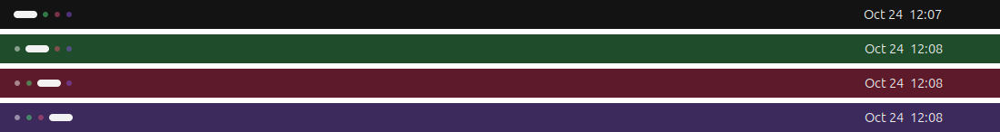
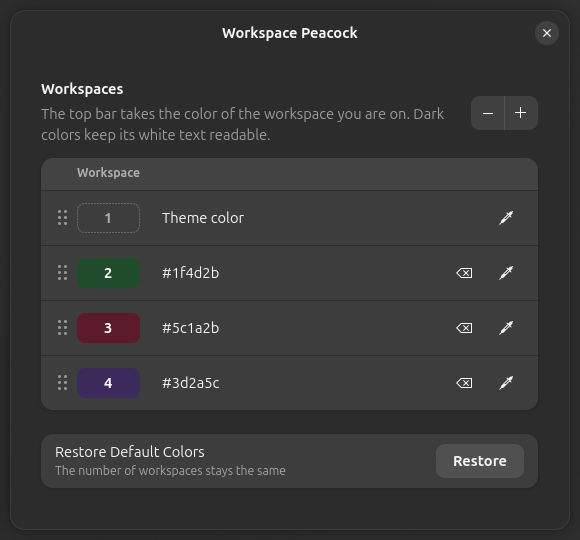

# Workspace Peacock

Workspace Peacock is [Peacock](https://marketplace.visualstudio.com/items?itemName=johnpapa.vscode-peacock)
for GNOME Shell workspaces: the top bar takes a different color on each workspace,
so a glance is enough to know where you are.

Peacock gives every VS Code window its own color, and after a while you stop reading
window titles. I wanted the same for virtual desktops, found nothing that let me pick
the colors, so I copied the idea, in a morning.



The workspace dots in the top left corner get a light shade of each workspace's
color, while the current one stays white; so do the dots of the popup you see when
switching from the keyboard, where the one you land on is colored too. The workspace
thumbnails of the overview take the full color. Turning the extension off puts everything
back as it was. Works with GNOME Shell 45 to 50.

## Installation

```sh
git clone https://github.com/amsis/gnome-shell-extension-workspace-peacock.git
cd gnome-shell-extension-workspace-peacock
glib-compile-schemas schemas/
mkdir -p ~/.local/share/gnome-shell/extensions
ln -s "$PWD" ~/.local/share/gnome-shell/extensions/workspace-peacock@amsis.github.io
```

Log out and back in, then `gnome-extensions enable workspace-peacock@amsis.github.io`.

## Colors

`gnome-extensions prefs workspace-peacock@amsis.github.io` opens the settings: one row
per workspace, click a row to pick its color, drag rows to reorder them, use + and −
to add or remove workspaces. A color too light for the white text gets a warning.



Or from the terminal:

```sh
gsettings --schemadir ~/.local/share/gnome-shell/extensions/workspace-peacock@amsis.github.io/schemas \
  set org.gnome.shell.extensions.workspace-peacock workspace-colors "['default', '#1f4d2b', '#5c1a2b']"
```

Hex, `rgb()` and color names work; `'default'` keeps the theme's color. Colors belong
to positions: with dynamic workspaces, closing one shifts the colors of those after it.

## License

Written by amsis, released under GPL-2.0-or-later (see [LICENSE](LICENSE)). I use it
every day, so it will follow new GNOME versions; pull requests are welcome.
